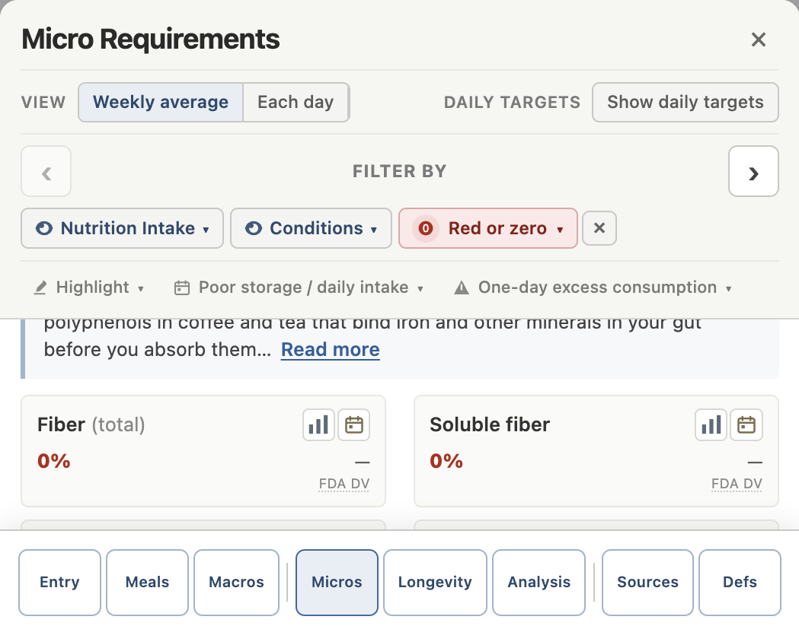
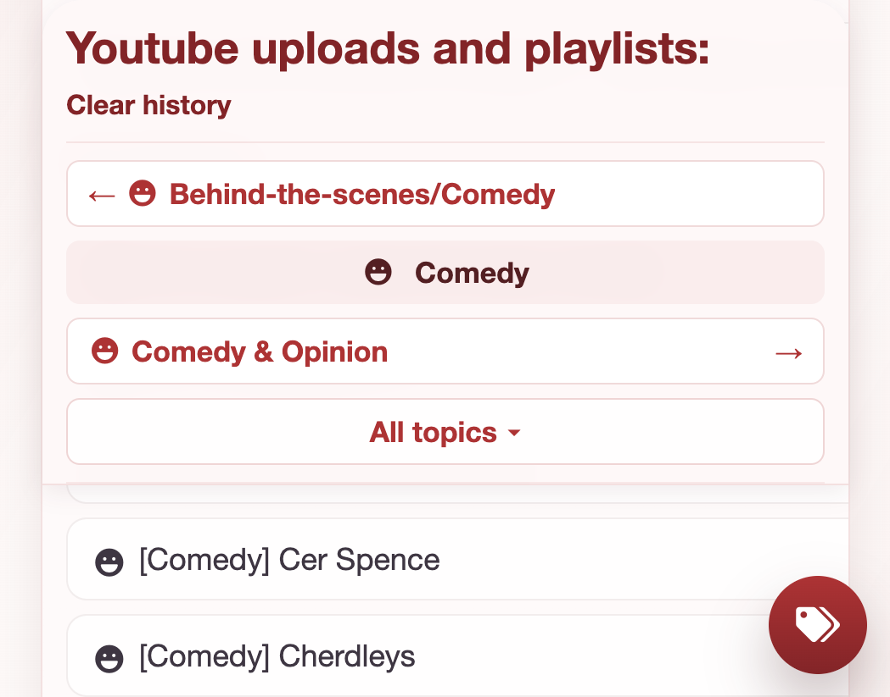

# Icon config layer

Match a label to an icon. A rule is a regular expression plus one of an emoji, a font class, an inline svg, or an image path. The first pattern that fits wins.

The nutrients tracker and the YouTube playlist app both hang icons on names. The sample rules cover words from those two places.

## Nutrients

Micronutrient cards use a bar icon for food sources and a calendar icon when a nutrient has to be eaten through the day.



## Playlists

Playlist names and the jump menu use the same match. Comedy is a smile, videogames a gamepad, Zelda a triforce, news a newspaper image.



## A rule

```php
array('pattern' => 'videogames|nintendo', 'font' => 'fas fa-gamepad'),
array('pattern' => 'zelda', 'svg' => '<svg ...></svg>'),
array('pattern' => '\\bnews\\b', 'src' => 'assets/icons/news.svg'),
array('pattern' => '\\btravel\\b', 'emoji' => '✈️'),
```

`pattern` is a regular expression. `flags` defaults to `i`. You can also write the pattern as `/zelda/i`.

`font` is a class from a library loaded by `icon-fonts.php`. Include that file in the page head, then add another link there when a rule needs a different library.

Put a narrower word before a broader one. `zelda` is listed before `videogames`, so a Zelda playlist keeps the triforce.

## Use it

```php
require __DIR__ . '/src/IconMatcher.php';

$icons = IconMatcher::load(__DIR__ . '/config/sample-rules.php');
echo $icons->html('Opinion/Videogames');
```

`html()` returns a `<span class="icon-match">`, or an empty string when nothing matches.

Serve this folder and open `index.php` to see the sample words.

```bash
php -S 127.0.0.1:8770
```
